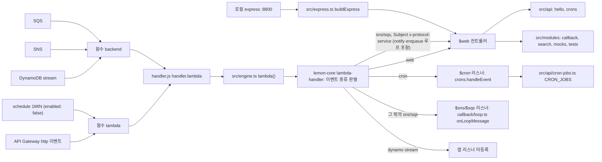

# lemon-templates-api

lemoncloud 백엔드 마이크로서비스(`<code>-<service>-api`)의 템플릿 저장소다.
새 서비스는 이 저장소를 복제해서 만든다.
이 README는 사람과 AI 에이전트의 진입점이다. 경로·명령·검증·금지 사항을 실제 파일 기준으로 적는다.

## 한눈에 보기

| 항목 | 값 |
|---|---|
| 런타임 | Node `24.15.0` (`.nvmrc`), `engines.node` `>=24.0.0`. Lambda 런타임은 `serverless.yml` `provider.runtime`이 env 설정에서 읽는다. |
| 언어·빌드 | TypeScript `^4.7.4`, `ttsc`(ttypescript)로 `src/` → `dist/` |
| 테스트 | jest `^29.7.0` + ts-jest `^29.4.15` (`src/**/*.spec.ts`). Lambda 도구(`lemon-*`)의 테스트는 lemon-core에 있다 |
| 프레임워크 | `lemon-core` `^5.0.15`. lemon-model은 lemon-core를 통해 온다(`field`·`fieldsOf`는 `lemon-core/model`). 이 서비스는 `lemon-model`을 직접 선언하지 않는다. 로컬 서버는 lemon-core `buildExpress()`의 로컬 API Gateway가 만든다(`src/express.ts`) — `serverless.yml` 라우트를 그대로 따르고(`{proxy+}`, 없는 경로·메서드는 403), `binaryMediaTypes`에 맞는 본문은 base64로 넘긴다. 앞단의 작은 내장 앱이 `src/express.ts`의 로컬 확장 라우트(`/echo`)를 받는다 — `express`·`lemon-devkit`은 쓰지 않는다(lemon-core 5.0.15, HOW_TO § 20). |
| AWS SDK | v3 (`@aws-sdk/*` `^3.1159.0`, lemon-core peer 범위와 같다). lemon-core가 쓰는 클라이언트를 이 서비스가 직접 선언한다 |
| 배포 | lemon-core `lemon-lambda-pack` → `lemon-lambda-deploy` → AWS Lambda. Serverless Framework 패키지는 설치하지 않는다 — `serverless.yml`은 함수 정의로 남고, `sls`로 쓰려면 [docs/serverless.md](docs/serverless.md) |
| 브랜치 | 기본 브랜치 `develop`. v5 라인은 `v5` 브랜치에 있다. |
| 패키지 버전 | `package.json` `version` |

## Lambda ZIP 패키징

`npm run pack`은 Docker의 Lambda Node 24 이미지에서 별도 빌드·운영 의존성 설치를 수행하고, 추출한 ZIP의 handler를 네트워크 없이 로드해 검증한다. 기본은 `x86_64`이며 `npm run pack -- --architecture arm64`로 바꿀 수 있다. ZIP과 외부 manifest는 `.artifacts/lambda/`의 새 디렉터리에 생성된다. 배포나 AWS 자격정보가 필요하지 않으며 기존 `pack.lemon` / `pack.lemon.prod`는 유지한다.

옵션·포함 경계·크기 제한·재현성과 검증 범위는 [Lambda ZIP 패키징](docs/lambda-pack.md)을 참고한다. 도구는 lemon-core의 `lemon-lambda-pack`이다. 테스트도 lemon-core에 있다.

## Lambda 로컬 실행

`npm run lambda:local -- --artifact <pack-result-dir> --event <event.json> --mode warm --runs 3 --json`은 검증·추출한 ZIP의 handler를 순수 Node 자식 프로세스로 실행한다. 개발 중에는 `--root <compiled-handler-dir>`을 쓸 수 있다. cold/warm 상태, timeout, context, 로그와 오류·소스맵을 확인하며 AWS 배포는 수행하지 않는다. 호스트 자격정보는 상속하지 않고 기본 네트워크 가드는 표준 Node 경로를 차단한다. 보안 sandbox나 실제 Lambda의 OS·IAM·메모리/CPU·freeze/thaw 재현은 아니다.

옵션과 결과 계약은 [Lambda 로컬 실행](docs/lambda-local.md)을 본다. 도구는 lemon-core의 `lemon-lambda-local`이다. 번들·축약·난독화와 비공개 소스맵 비교는 [bundle lab](docs/lambda-bundle-research.md) 및 `npm run bundle:lab`으로 실행한다(tool 의존성 설치는 해당 문서 참고).

## 저장소 지도

| 경로 | 내용 | 누가 고치나 |
|---|---|---|
| `handler.js` | Lambda 진입점. `dist/index`의 `engine()`을 export 한다. | 거의 안 고침 |
| `src/index.ts` | `engine()`·`express()` 로더. 직접 실행하면 express 서버를 띄운다. | 거의 안 고침 |
| `src/engine.ts` | lemon-core 엔진. 웹 컨트롤러, cron 리스너, SNS·SQS 루프 테스트 리스너를 등록한다. | 기능 추가 시 |
| `src/express.ts` | 로컬 express 서버. `POST /echo`를 더한다. | 거의 안 고침 |
| `src/api/` | 모델 없는 컨트롤러(`hello-api.ts`, `crons-api.ts`)와 cron 목록(`cron-jobs.ts`) | 개발자 |
| `src/modules/<name>/` | 모델 있는 기능 모듈. `mock`(골든 샘플), `callback`, `search` | 개발자 |
| `src/modules/callback/loop.ts` | 루프 테스트(SNS·SQS·protocol·notify·enqueue). 라우트는 `api-callback.ts`의 `doPostLoop()`·`doPostLoopRecv()`다. | 개발자 |
| `src/service/` | `BackendService`·`BackendProxy`·`ModelType` 등 모듈 연결 지점 | 기능 추가 시 |
| `src/view/` | 외부 공개 타입(`types.ts`)과 transformer 묶음 | 기능 추가 시 |
| `src/test-helpers/` | 테스트용 컨텍스트 샘플(`loadSample`) | 개발자 |
| `data/` | 더미 데이터(`dummy-data.yml` 등)와 배치 샘플(`batch/`). Lambda 패키지에 들어간다. | 개발자 |
| `sample/` | 컨텍스트·응답 예시 JSON | 참고용 |
| `swagger/documentation.yml` | `serverless-aws-documentation` 설정 | 개발자 |
| `@types/` | 타입 패키지 `@lemoncloud/<name>`. `dist/`와 `package.json`은 `npm run types`가 다시 만든다. | **`dist/`는 손으로 고치지 않음** |
| `serverless.yml` | 함수·이벤트·IAM·리소스 이름 맵. `serverless-vpc.yml`은 VPC 설정이 켜진 변형이다. | 사람 검토 필수 |
| `env/` | 프로필·스테이지 설정 | **에이전트는 열지 않음** |
| `docs/lambda-*.md` | Lambda 도구(lemon-core `lemon-*` 명령)의 이 서비스 사용법. 목록은 [docs/lambda-tools.md](docs/lambda-tools.md) | 개발자 |

## 요청 흐름



- 두 함수 모두 같은 `handler.lambda`를 쓴다. 함수별 이벤트는 `serverless.yml` `functions:`에 있다.
- `src/engine.ts`는 웹 컨트롤러 6개, cron 리스너 1개, SNS·SQS 리스너 각 1개를 등록한다. DynamoDB stream 리스너는 없다.
- SNS·SQS 리스너는 루프 테스트 전용이다. 제목 `x-loop-test` 메시지만 처리한다. 다른 메시지는 무시한다.
- 루프 테스트는 callback 모듈에 있다. 트리거는 `POST /callback/<kind>/loop`(admin만)다. `kind`는 `sns`·`sqs`·`protocol`·`notify`·`enqueue`다.
- protocol 루프의 수신부는 `POST /callback/<loopId>/loop-recv`다. `//self`는 `lambda` 함수다.
- `notify`·`enqueue`는 protocol 서비스로 SNS·SQS를 거친다. `backend`가 `loop-recv`를 실행한다.
- 루프 테스트 수신부는 로그만 남긴다. 재발신하지 않는다. 가드는 다음과 같다.
  1. 수신부(SNS·SQS 리스너, `loop-recv`)는 로그만 남기고 돌아간다.
  2. 트리거는 protocol 경유 재진입을 거부한다(`400 INVALID LOOP - nested trigger`).
  3. `hop`은 1만 받는다. 수신부는 `hop`을 올려 다시 보내지 않는다.
  4. SNS·SQS 리스너는 throw 하지 않는다. protocol 경유 `loop-recv`도 throw 하지 않는다.
  5. 오류 보고는 `REPORT_ERROR_ARN` 토픽으로 간다. `backend`가 구독한 토픽이 아니다.
  6. 앱 코드에 cron·재시도 루프가 없다. `loop:check`는 kind마다 한 번만 호출한다.
  7. `notify`·`enqueue`는 callback을 넘기지 않는다.
- 내부 호출(protocol)은 lemon-core relay로 간다(B14). 호출자 context 전체를 보내지 않는다.
  - 송신: web은 헤더 `x-lemon-relay`, SNS·SQS는 param 필드 `relay`를 싣는다. relay에는 identity 요약(`sid`·`uid`·`gid`·`roles`·`identityId`·`lang`)과 trace만 있다.
  - `x-protocol-context`는 기본으로 보내지 않는다(`PROTOCOL_LEGACY_CONTEXT=off`).
  - 수신: 진입 지점이 `context.channel`을 정한다. Host가 있는 web은 `external`, Host 없는 직접 invoke는 `internal`, 로컬 express는 `local`, protocol 수신(web relay·SNS·SQS)은 `internal`이다.
  - `context.trace`는 `{ tid, hop }`이다. 외부 진입은 `hop` 0이다. protocol hop마다 lemon-core가 `hop`을 1 올린다. `tid`는 사슬 전체에서 같다.
  - 루프 테스트는 `trace.hop > 0`을 protocol 경유로 본다. `depth`를 손으로 올리지 않는다.
  - `[LOOP] send`·`recv`·`done` 줄 끝에 ` tid=<tid> hop=<hop>`이 붙는다. CloudWatch에서 `tid` 하나로 두 함수의 줄을 잇는다.
- 자세한 내용: [docs/lambda-tools.md](docs/lambda-tools.md#loopcheck), [src/modules/callback/README.md](src/modules/callback/README.md)
- 일반 라우트 `/{type}/{id}/{cmd}`에는 `authorizer: aws_iam`이 붙는다. `/`·`/hello`·`/mocks` 명시 라우트에는 없다.

## 기능을 어디에 넣나

- **모델이 없으면** `src/api/<name>-api.ts`에 `GeneralWEBController`를 상속해 만든다. 예시는 `hello-api.ts`다.
- **cron 작업이면** `src/api/cron-jobs.ts`의 `CRON_JOBS`에 항목을 더한다.
- **모델이 있으면** `src/modules/<name>/`를 만든다. `src/modules/mock/`를 복사한다. `TestModel`이 골든 샘플이다.
- 모듈 파일 세트: `types.ts`, `model.ts`, `views.ts`, `transformer.ts`, `service.ts`(ModelManager), `proxy.ts`(ManagerProxy), `api-<name>.ts`(`AbstractCRUDController`), 그리고 각 `*.spec.ts`.
- `search`는 OS2 검색 모듈이다. `model.ts`·`service.ts`·`api-search.ts`만 있다. [HOW_TO_USE_OS2.md](HOW_TO_USE_OS2.md)를 본다.
- 새 모듈은 다음 지점에 연결한다.
  - `src/engine.ts`: `$web.addController(...)`
  - `src/service/backend-types.ts`: `$LUT.ModelType`에 모듈 `ModelType` 병합
  - `src/service/backend-service.ts`: `$<name>` 모델 매니저
  - `src/service/backend-proxy.ts`: 매니저 proxy
  - `src/view/types.ts`: 타입 패키지로 내보낼 view
- 새 type은 일반 라우트(`aws_iam`)로 들어온다. 인증 없는 경로가 필요하면 `serverless.yml`에 명시 라우트를 둔다.
- proxy를 추가·변경하면 [docs/proxy-implementation-guide.md](docs/proxy-implementation-guide.md)를 먼저 본다.
- 모듈 규칙: [src/modules/mock/README.md](src/modules/mock/README.md), [src/modules/callback/README.md](src/modules/callback/README.md)

## 명령

| 명령 | 하는 일 | 주의 |
|---|---|---|
| `nvm use` | `.nvmrc`의 Node로 맞춘다 | |
| `npm install` | 의존성 설치 | `package-lock.json` 사용 |
| `npm run build` | `ttsc` → `dist/` | |
| `npm test` | `LS=1 jest` | 커버리지는 `coverage/` |
| `npm run test:watch /mock/` | 패턴에 맞는 spec만 감시 실행 | 모듈 README 예시 참고 |
| `npx tsc --noEmit` | 타입 검사만 | 파일을 쓰지 않는다 |
| `npm run lint` | `tsc --noEmit` + `eslint --fix` | **파일을 고쳐 쓴다** |
| `npm run fields:types` | `$FIELD` 모델의 같은 필드 이름이 한 타입인지 검사(lemon-core `lemon-fields-types`, 한 OpenSearch 인덱스 기준) | 쓰지 않는다. `hard` 충돌이면 exit 1. `-- --fail-on order`로 순서 의존 충돌도 실패로 |
| `npm run express.lemon` | `ENV=lemon STAGE=local LOCAL_TRANSPORT=mock`로 빌드·watch·nodemon 실행 | 포트는 `package.json` `port`(8800). 자기 서비스로 가는 SNS·SQS·protocol 발신을 프로세스 안에서 전달한다(lemon-core 로컬 전송). 다른 대상은 `501`이다 |
| `npm run express.lemon.aws` | `ENV=lemon STAGE=local`로 실행(예전 동작) | 발신이 실제 AWS로 간다 |
| `npm run types` | `@types/` 패키지 재생성 | 끝에 `npm publish --dry-run`을 돈다 |
| `npm run lambda:invoke -- ...` | 배포된 함수 호출(`lemon-lambda-invoke`) | [docs/lambda-tools.md](docs/lambda-tools.md) |
| `npm run lambda:logs -- ...` | CloudWatch 로그 조회·추적(`lemon-lambda-logs`) | [docs/lambda-tools.md](docs/lambda-tools.md) |
| `npm run perf:lambda -- ...` | 반복 호출, cold/warm 시간 요약(`lemon-lambda-perf`) | [docs/lambda-tools.md](docs/lambda-tools.md) |
| `npm run fields:admin -- --target express\|lambda` | `GET /<type>/fields/admin` 점검(`lemon-fields-admin`) | [docs/lambda-tools.md](docs/lambda-tools.md#fieldsadmin) |
| `npm run loop:check -- ...` | SNS·SQS·protocol 루프 테스트를 로그 줄로 점검(`lemon-loop-check`) | [docs/lambda-tools.md](docs/lambda-tools.md#loopcheck) |
| `npm run loop:check -- --target express` | 로컬 서버(`express.lemon`)에서 루프 테스트 다섯 kind 점검 | AWS 불필요. 응답의 `mock`·`recv`로 판정 |

**사람만 실행** — 에이전트는 사람이 명시적으로 시킬 때만 돌린다.

| 명령 | 하는 일 |
|---|---|
| `npm run lambda:deploy -- --apply ...` | 배포 실행(`lemon-lambda-deploy`). 기본은 계획만 보인다. [docs/lambda-deploy.md](docs/lambda-deploy.md) |
| `npm run lambda:migrate` / `lambda:deploy:dev` | 가드된 이행·dev 릴리스. [docs/lambda-migrate.md](docs/lambda-migrate.md) |
| `npm run deploy:dev` | 수동 dev 배포 한 명령(`bin/deploy-dev.sh`): pack → 계획 → `--apply` → GET `/`·`/hello/0` 확인. 기본 `dev`·`profile=lemon`, 설정 `.artifacts/deploy.code.dev.json`이 없으면 비공개 레인 폴더에서 한 번 만든다. `--plan-only`면 계획까지만. [docs/lambda-tools.md](docs/lambda-tools.md#manual-dev-deploy-bindeploy-devsh) |

Serverless Framework 패키지(`sls`)는 설치하지 않는다. 설정 파일 `serverless.yml`·`serverless-vpc.yml`은 남아 있고, `sls`로 직접 배포·운영하려면 [docs/serverless.md](docs/serverless.md)의 권장 구성(패키지·스크립트)을 다시 넣는다.

소스 주석의 `:8888` 예시는 꺼진 `serverless-offline`의 포트다. 로컬 express 포트는 8800이다.

## 작업 검증

완료라고 말하기 전에 아래를 돌린다.

```sh
npx tsc --noEmit        # 기대: 출력 없음, exit 0
npm test                # 기대: jest 요약에 failed 0, exit 0
```

- 테스트가 실패하면 테스트가 아니라 코드를 고친다.
- 모델 필드 목록은 모델 클래스의 `@field()`에서 나온다(`fieldsOf()`, lemon-core v5 B4). 저장 필드를 더하면 `@field()`를 붙인다. 빠뜨리면 그 값은 `.meta`로 들어간다. 이 변경부터 목록은 부모(`CoreModel`) 필드가 먼저다. 그래서 head 객체(`asHead()` → `parent$`·`mock$`)와 search `$param`의 키 순서도 새 순서를 따른다. 값과 저장 필드는 그대로다.
- 모델 필드를 바꾸면 `src/modules/mock/fields-admin.expected.json`의 `counts`·`extra`도 고친다.
- 로컬 서버(`LOCAL_MODE=1`)가 떠 있으면 `npm run fields:admin -- --target express`로 점검한다. 기대: exit 0.
- 루프 테스트를 바꿨으면 로컬에서 먼저 점검한다. 서버는 `npm run express.lemon`으로 띄운다.

```sh
npm run loop:check -- --target express --kind all   # 기대: 다섯 줄 모두 send=ok recv=ok, exit 0
```

- 서버 로그에 kind마다 `[MOCK] deliver` 줄 1개와 `[LOOP] recv` 줄 1개가 있다.
- 로컬 전송은 발신만 바꾼다. 서버 시작 때 설정 복호화(KMS)는 그대로 AWS를 쓴다.

배포 후 점검(사람이 dev에 배포한 뒤, dev 스테이지만):

```sh
npm run fields:admin -- --target lambda --stage dev   # 기대: ok=true, gate=closed(403), exit 0
npm run lambda:invoke -- --stage dev --path /hello/0  # 기대: function-error=none, http 200
npm run lambda:logs -- --stage dev --since 5m         # 오류 줄 확인
npm run loop:check -- --stage dev                     # 기대: 다섯 줄 모두 send=ok recv=ok, exit 0
```

- `loop:check`는 kind마다 `lambda`를 한 번 호출한다. 그 뒤 `[LOOP] recv` 줄을 로그에서 찾는다. 기본 대기는 60초다.
- 같은 점검을 손으로 하려면 먼저 트리거를 호출한다. 응답의 `loopId`를 적는다.

```sh
npm run lambda:invoke -- --stage dev --internal --identity '{"sid":"loop-check","roles":["admin"]}' --method POST --path /callback/sns/loop
npm run lambda:logs -- --stage dev --fn backend --since 5m --filter '"<loopId>"'   # protocol만 --fn lambda
```

- `lambda:invoke`는 `http 4xx/5xx`여도 exit 0이다. 출력의 `http` 줄을 본다.

## 에이전트 규칙

- `env/*.yml`·`env/config.js`를 열지 않는다. 그 값을 출력·인용하지 않는다.
- `/hello/environ`을 호출하지 않는다. 그 응답을 붙이지 않는다. 스테이지·프로필·테이블·큐·토픽 설정값을 그대로 돌려준다.
- Lambda 도구(`lemon-*`)에 `--raw`를 쓰지 않는다. 계정·ARN·토큰 마스킹이 꺼진다.
- deploy·pack·info·`sls logs`·remove는 사람이 명시적으로 시킬 때만 돌린다.
- prod 스테이지 호출은 하지 않는다. Lambda 도구의 stage guard는 dev 외 스테이지에 `--confirm-stage <stage>`를 요구한다. 이 플래그는 사람의 명시 지시가 있을 때만 붙인다.
- 작업 전에 브랜치를 만든다. v5 라인 작업의 base는 `v5`다.
- 생성·자동 관리 파일(`@types/dist/`, `docs/proxy-implementation-guide.md`, 아래 proxy 블록)을 손으로 고치지 않는다.
- `npm run lint`는 파일을 고쳐 쓴다. 의도한 경우에만 돌린다.
- 문서와 소스가 다르면 소스가 맞다.

## 새 서비스로 복제할 때

- [ ] `package.json`의 `name`·`description`·`repository.url`·`version`을 바꾼다.
- [ ] `serverless.yml`의 `service:`를 바꾼다. Lambda 도구의 함수 이름(`<service>-<stage>-<fn>`)이 이 값에서 나온다.
- [ ] `serverless.yml` `custom`의 `topicName`·`tableName`·`queueName` 스테이지별 맵을 바꾼다. IAM·환경변수·`resources`가 이 맵을 참조한다.
- [ ] `serverless.yml` schedule `name`의 접두어를 바꾼다.
- [ ] `npm run types`로 `@types/package.json`을 다시 만든다. 이름은 `@lemoncloud/<package.json name>`이 된다. `@types/README.md` 제목도 바꾼다.
- [ ] 쓰지 않는 샘플 모듈은 위 연결 지점과 `serverless.yml` 명시 라우트에서 함께 뺀다.
- [ ] 이 README의 제목·소개·VERSION INFO를 바꾼다. proxy 블록은 그대로 둔다.
- [ ] `env/` 설정은 사람이 준비한다.

## 문서 색인

| 문서 | 내용 |
|---|---|
| [docs/lambda-tools.md](docs/lambda-tools.md) | Lambda 도구(lemon-core `lemon-*` 명령) 스크립트 표, 이 서비스가 읽히는 파일, AWS SDK 패키지, `fields:admin`·`loop:check` 서비스 메모. 옵션·안전 규칙·exit code는 lemon-core `docs/v5/B19-bin-tools.md`·`docs/v5/B19-bin-deploy.md` |
| [src/modules/mock/README.md](src/modules/mock/README.md) | `TestModel` 골든 계약, 함께 고칠 파일, `fields/admin` 점검 |
| [src/modules/callback/README.md](src/modules/callback/README.md) | callback 모듈 설계 개념, 루프 테스트 라우트와 가드 |
| [docs/proxy-implementation-guide.md](docs/proxy-implementation-guide.md) | `BackendProxy`·`ManagerProxy`·`guardProxy()`와 use-case 구현 가이드 (이 저장소 소유) |
| [docs/dependency-audit.md](docs/dependency-audit.md) | 운영 의존성 `npm audit` 점검 기록 |
| [HOW_TO_UPGRADE_V4.md](HOW_TO_UPGRADE_V4.md) | lemon-core v3 → v4 업그레이드 가이드 (과거 기록) |
| [HOW_TO_USE_OS2.md](HOW_TO_USE_OS2.md) | OS2를 FGAC JWT로 쓰는 방법 |
| [@types/README.md](@types/README.md) | 타입 패키지 소개 |

----------------

## VERSION INFO

| Version   | Description
|--         |--
| 5.26.xxx  | optimized `lemon-core@5.0.5` since 2026. (`^5.0.5` — local transport, see [docs/dependency-audit.md](docs/dependency-audit.md))
| 0.25.808  | optimized `lemon-core@4.0.6` initially.

## Proxy

Proxy 기능을 추가하거나 바꿀 때는 [docs/proxy-implementation-guide.md](docs/proxy-implementation-guide.md)를 먼저 확인한다.
`BackendProxy`, `ManagerProxy`, `guardProxy()` 계열 동작과 프로젝트 적용 절차는 이 문서 기준으로 맞춘다.
이 문서는 예전에 lemon-devkit이 설치 때 써 넣던 사본에서 시작했고, 지금은 이 저장소가 소유한다(손으로 고친다).

### Verified ZIP deployment through eureka-deploy

`npm run lambda:deploy -- --config <config.json> --artifact <pack-output>` validates the pack artifact and prints an offline deployment plan. Add `--apply` explicitly to run a managed code update or full bootstrap through eureka-deploy. See [Lambda deployment CLI](docs/lambda-deploy.md) for the example config, extra read-only preflight permissions, verification and interrupted-run recovery. Existing Serverless deployment commands are unchanged.

### Templates dev 이관과 코드 배포

`npm run lambda:migrate -- plan --config .artifacts/migration.dev.json`은 고정된 eureka 소스와 명시적 설정을 검사해 오프라인 계획을 출력한다. 실제 단계 실행은 `--execute`, 민감 백업 수집은 추가 동의 플래그, 스택 삭제는 정확한 스택 확인이 필요하다. 이관은 기존 배포 코드를 먼저 복원하고 검증한 뒤 새 ZIP을 적용하는 순서다.

`npm run lambda:deploy:dev -- --config .artifacts/deploy.dev.json --artifact <pack-output>`은 templates/dev/code 전용 배포 계획을 만든다. 선택적으로 완료된 이관 영수증을 연결할 수 있으며 실제 배포는 `--apply`로 실행한다. 예제 설정·단계·개인 백업·중단 복구와 한계는 [Templates dev 이관 가이드](docs/lambda-migrate.md)를 참고한다. 도구와 테스트는 lemon-core(`lemon-lambda-migrate`·`lemon-lambda-deploy-dev`)에 있다.
