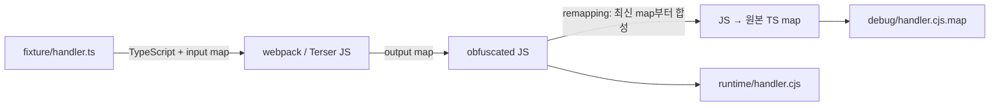

# Lambda 번들·식별자 축약·난독화 실험

이 실험은 같은 TypeScript fixture를 일반 코드, webpack/Terser 축약 코드, 난독화 코드로 실행하고 크기·빌드·초기화·호출 비용과 오류 위치 복원을 비교한다. 서비스의 기존 `pack` 경로나 production dependency를 변경하지 않는다. **식별자 축약과 난독화는 암호화나 개인정보 익명화가 아니다.** 실행 가능한 JavaScript, 문자열, API 프로퍼티가 남으므로 비밀정보 보호를 맡길 수 없다.

구현은 `tools/lambda-bundle/`의 독립 패키지다. 서비스 TypeScript/lockfile과 분리해 다음 도구를 exact pin하고 자체 `package-lock.json`을 사용한다. 2026-10-30 npm registry 조회값은 webpack `5.112.2`, Terser `5.51.2`, terser-webpack-plugin `5.6.1`, javascript-obfuscator `5.9.0`, `@jridgewell/remapping` `2.3.5`였다. fixture의 `transpileModule` API에는 별도로 확인한 안정 버전 TypeScript `5.9.3`을 고정했다. 이는 서비스 컴파일러의 교체가 아니며 최신 TypeScript라는 주장도 아니다.

## 실행

저장소 루트, Node 24에서 실행한다. 서비스의 `npm ci`와 독립된 설치 단계다.

```sh
npm ci --prefix tools/lambda-bundle --ignore-scripts
npm test --prefix tools/lambda-bundle
npm run experiment --prefix tools/lambda-bundle -- --runs 10 --build-runs 3
```

`experiment`는 각 profile을 3회 빌드하고 마지막 빌드를 cold 10회, warm 10회 실행한다. 마지막에 profile별 오류 1회도 실행하여 원본 줄 복원을 확인한다. 두 반복 수는 각각 2~100이며 기본값은 10/3이다. JSON 출력의 `reportFile`에 모든 표본·중앙값·환경·측정 경계가 저장된다. 빌드만 필요하면 `npm run build --prefix tools/lambda-bundle`을 쓴다. 매번 새 `.artifacts/bundle-lab/build-*` 디렉터리를 만들며 이전 결과를 덮어쓰지 않는다.

출력된 build 디렉터리를 아래 변수에 넣어 [Node 로컬 하네스](lambda-local.md)로 직접 실행할 수도 있다.

```sh
BUILD_DIR='.artifacts/bundle-lab/build-...'
npm run lambda:local -- \
  --root "$BUILD_DIR/obfuscated/runtime" \
  --handler-file handler.cjs --handler-export lambda \
  --event tools/lambda-bundle/fixture/event.json --mode warm --runs 5 --json
```

fixture는 숫자 배열의 제곱합·SHA-256, 요청 ID, 모듈 호출 카운터를 반환한다. `fixture/error-event.json`은 의도적으로 실패한다. 외부 서비스나 네트워크가 필요하지 않다. 성공 결과·warm 상태 유지·cold 초기화는 실험이 assert하며, 하나라도 어긋나면 보고서를 성공으로 저장하지 않는다.

## 세 profile과 변환 경계

| Profile | 변환 | 비교 의미 |
| --- | --- | --- |
| `baseline` | TypeScript → CommonJS JavaScript, 주석 제거 | 일반 컴파일 기준 |
| `webpack-minified` | TypeScript loader → webpack → Terser | bundling과 minify를 함께 더한 결과 |
| `obfuscated` | 위 축약 JS → javascript-obfuscator → map 합성 | 축약 결과에 보수적 식별자 난독화를 추가한 증분 |

webpack은 `target: 'node24'`, `commonjs2` library output을 쓴다. `node:crypto`는 Node builtin external로 남으며 `handler.cjs`의 `lambda` export와 응답 프로퍼티를 유지한다. Node target은 webpack 런타임의 언어·로딩 방식을 정하는 설정이며 Lambda의 OS/ABI를 검증하지 않는다. [webpack target](https://webpack.js.org/configuration/target/), [externals](https://webpack.js.org/configuration/externals/).

Terser는 지역 식별자를 축약하고 프로퍼티 mangling을 끈다. 실험은 오류 프레임을 쉽게 관찰하도록 함수 inline/reduce_funcs도 끈다. 이름을 문자열로 조회하거나 `Function.name`/클래스 이름에 의존하는 실제 코드에는 별도 보존 정책과 행동 검증이 필요하다. 프로퍼티 이름 변경은 일반 변수명 축약과 다른 옵션이며 외부 계약·동적 접근을 깨뜨릴 수 있다. [Terser 옵션과 property mangling](https://github.com/terser/terser#cli-mangling-property-names---mangle-props).

난독화는 로컬 `obfuscate()` API, `target: 'node'`, 고정 seed, hexadecimal identifier를 쓴다. global/property renaming, control-flow flattening, dead-code injection, debug protection, self-defending, console 제거, string-array 변환, object-key 변환, 광고·로그를 끈다. Pro API나 원격 코드 전송은 사용하지 않는다. 완전한 리버스 엔지니어링 방어가 아닌, 한정된 변환 비용을 관찰하는 profile이다. [javascript-obfuscator API와 옵션](https://github.com/javascript-obfuscator/javascript-obfuscator#javascript-obfuscator-options).

## 원본 위치 복원과 map 관리



fixture 전용 loader는 `this.callback(null, JavaScript, TypeScriptMap)`으로 원본 매핑을 webpack에 넘긴다. webpack map은 이미 JS→TS를 가리키므로 `remapping([obfuscatorMap, webpackMap], () => null)`으로 마지막 단계를 합성한다. 이 loader는 단일 fixture transpilation 도구이며 서비스 type-check/build를 대체하지 않는다. [webpack loader callback](https://webpack.js.org/api/loaders/#thiscallback), [remapping의 newest-first 배열 API](https://github.com/jridgewell/remapping#multiple-transformations-of-a-file).

각 profile의 파일은 다음과 같다.

| 파일 | 용도 |
| --- | --- |
| `runtime/handler.cjs` | 실행할 유일한 파일. map URL·inline map·원본 TS 없음 |
| `debug/handler.cjs.map` | `sourcesContent`를 포함한 전체 원본 map, 실행 폴더 바깥 |
| `manifest.json` | build ID, profile, 실행 코드 SHA-256, map SHA-256, source SHA-256, 버전·크기 |
| `debug/raw-stack.txt`, `debug/restored-stack.json` | 실험이 남기는 복원 증거 |

webpack의 `hidden-source-map`은 참조 주석만 숨기며 map 자체를 비공개로 만드는 접근 제어가 아니다. 이 실험은 map을 runtime에 넣지 않고 전체 `.artifacts/`를 Git에서 제외한다. debug/manifest는 따로 보관해야 한다. `nosources-source-map`도 파일명과 구조는 노출한다. [webpack devtool](https://webpack.js.org/configuration/devtool/#production).

Node 하네스가 `--enable-source-maps`를 켜도 연결 주석이 없는 이 profile은 자동 복원되지 않는다. 별도 도구는 `node:module`의 `SourceMap.findEntry`를 사용하며 V8의 1-based 좌표를 0-based offset으로 변환한다. 원본 파일·줄·열을 복원하며 원본 함수명 복원을 보장하지 않는다. [Node 24 source maps](https://nodejs.org/download/release/v24.20.0/docs/api/cli.html#--enable-source-maps), [SourceMap API](https://nodejs.org/download/release/v24.20.0/docs/api/module.html#class-modulesourcemap).

```sh
BUILD_ID='copy-buildId-from-report'
npm run symbolicate --prefix tools/lambda-bundle -- \
  "$BUILD_DIR/obfuscated" "$BUILD_ID" \
  "$BUILD_DIR/obfuscated/debug/raw-stack.txt"
```

복원 전에 manifest의 build ID, 실제 JS SHA, 실제 map SHA, map 내부의 build/profile/code SHA 결합을 확인한다. 다른 코드 또는 map은 거부한다. 이는 신뢰하는 빌드 기록 간 혼동을 방지하며 manifest를 공격자가 함께 바꾸는 상황의 서명/인증 기능은 아니다.

복사된 임시 디렉터리나 `/var/task/handler.cjs`에서 나온 stack은 **정확한 실행 경로와 해당 실행에 기록한 코드 SHA**를 명시한다. basename으로 추측하지 않는다.

```sh
CODE_SHA='copy-codeSha256-from-the-recorded-execution-build'
npm run symbolicate --prefix tools/lambda-bundle -- \
  "$BUILD_DIR/obfuscated" "$BUILD_ID" raw-stack-from-runtime.txt \
  --generated-file /var/task/handler.cjs --code-sha256 "$CODE_SHA"
```

다른 profile의 SHA는 거부한다. 외부 실행 때 build/profile/code SHA를 별도 메타데이터로 기록해야 하며 stack 문자열 자체가 코드 출처를 인증하지는 않는다. 프레임이 하나도 일치하지 않으면 `status: "unmatched"`, CLI exit 1이다. 일치한 frame만 복원하고 Node 내부 프레임 등은 원문으로 남긴다.

## 관측 결과: synthetic fixture

2026-10-30, Node `v24.20.0`, macOS/darwin arm64, OS release `25.6.0`. build ID `1b5e4445-3974-4804-a72b-ac3096986dd4`, 로컬 기록 `.artifacts/bundle-lab/build-f8AKF8/report.json`의 한 실행이다. 이 경로의 산출물은 Git에 넣지 않으므로 새 checkout에서는 위 명령으로 새 보고서를 만든다.

| Profile | JS bytes | gzip JS bytes | private map bytes | build 중앙값 ms (N=3) | cold init 중앙값 ms (N=10) | cold invoke 중앙값 ms (N=10) | warm steady invoke 중앙값 ms (N=9) |
| --- | ---: | ---: | ---: | ---: | ---: | ---: | ---: |
| baseline | 807 | 474 | 1,963 | 3.411 | 17.088 | 0.237 | 0.015 |
| webpack-minified | 721 | 489 | 3,353 | 26.223 | 16.567 | 0.232 | 0.013 |
| obfuscated | 1,257 | 684 | 3,851 | 35.987 | 16.597 | 0.226 | 0.016 |

축약은 이 fixture의 JS를 줄였지만 gzip 결과는 webpack 부트스트랩 때문에 더 컸다. 난독화는 축약본보다 JS와 map을 키웠다. 짧은 실행 시간의 차이는 잡음 수준이므로 속도 우열이나 Lambda cold-start 개선으로 일반화하지 않는다. baseline→minified 차이에는 bundling 비용도 섞인다. gzip은 참고용 코드 압축이며 배포 ZIP 크기가 아니다.

빌드 시간의 baseline은 메모리 내 TypeScript transpilation이다. webpack 구간에는 compiler 생성, TypeScript/webpack/Terser 처리, staging 파일 emit/read와 compiler close가 포함된다. 도구 import와 최종 runtime/debug/manifest 저장은 제외한다. 한 프로세스에서 순차 빌드하며 webpack filesystem cache는 끄지만 process/module cache는 유지된다. 첫 build가 후속보다 오래 걸린 표본도 보고서에 그대로 남긴다. obfuscated의 total에는 같은 회차의 webpack 구간과 추가 난독화·map 합성을 합산한다. 완전히 새 프로세스의 설치/CLI 시작 시간을 뜻하지 않는다.

cold는 매번 새 child/module, warm은 한 child의 순차 호출이다. `initMs`는 child의 network guard·handler import·event-loop/log flush 구간이고, 프로세스 생성은 `totalMs`에 포함된다. `invokeMs`는 handler await 및 JSON 결과 변환이다. warm steady는 첫 호출을 뺀 9개 표본이다. 고정 profile 순서, CPU 격리 없음, 작은 fixture라는 한계가 있다. IAM·VPC·AWS 서비스·freeze/thaw·Lambda 자원 할당·실제 배포 cold start는 측정하지 않았다.

60회 정상 호출의 결과·상태와 3회 의도한 오류를 확인했다. 세 profile 모두 `fixture/handler.ts:19:11`로 복원됐다. `npm test --prefix tools/lambda-bundle`의 13개 행동 테스트는 CJS export/응답/상태, 정확한 TS 오류 줄, runtime map 누출 없음, build/code/map 불일치 거부, 동일 입력의 실행 코드 재현, 다른 실행 경로와 미일치 처리를 확인한다. 초기 실패였던 webpack 원본 파일명 매핑과 baseline 원본 주석 보존도 수정 후 통과했다.

## 실제 templates에 적용하기 전

현재 `handler.js:20`은 `source-map-support`를 설치하고 `handler.js:29-32`는 환경변수 `SRC`로 동적 `require` 대상을 결정한다. 이 경로를 그대로 정적 번들 입력으로 넣으면 필요한 파일을 빠뜨리거나 불필요한 context bundle을 만들 수 있다. 현재 pack(lemon-core `lemon-lambda-pack`)은 lemon-core의 `pack-core.mjs`에서 lock의 dependency/peer 정보를 검증·유지하고 production 설치물을 모은다. 이 실험은 그 계약을 대체하지 않는다.

후속 실험은 소유한 서비스 코드와 외부 dependency를 구분해야 한다. 서비스 코드의 명시 entry를 bundle하고 라이브러리·native addon·peer dependency를 external로 둘 경우, external의 실제 파일도 Linux 배포 패키지에 포함해야 한다. 프로퍼티/함수명 반사, 동적 require, 데이터 파일, side effect와 초기화 순서, 공개 export를 실서비스 경로로 검증한 뒤 범위를 넓힌다. 제삼자 코드를 난독화하거나 license 주석을 제거하는 정책도 별도로 판단해야 한다. fixture에는 제삼자 JS 소스를 bundle하지 않는다.

현재 결론은 재현 가능한 조사 도구와 복원 검증이 준비됐다는 것이다. production bundling/minification/obfuscation 기본값 채택이나 AWS 배포 승인은 포함하지 않는다.
