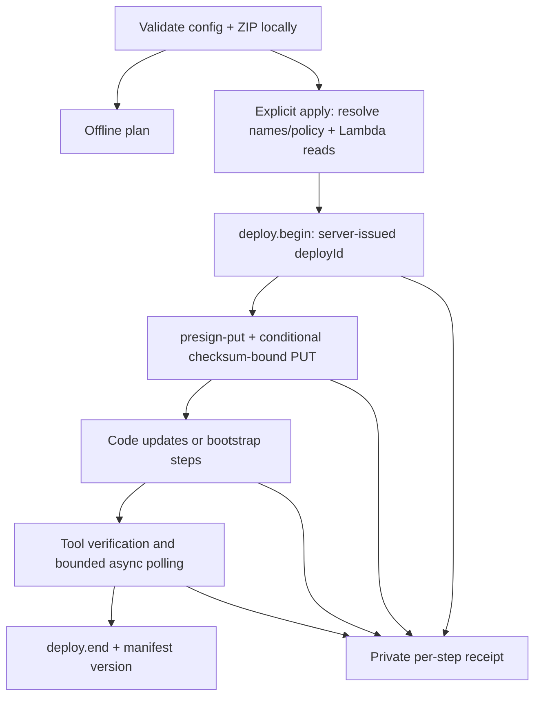

# Deploy verified Lambda ZIPs through eureka-deploy

Since lemon-core 5.0.13 (v5 B19) the tools are the lemon-core bins `lemon-lambda-deploy` and `lemon-lambda-deploy-dev`; `npm run lambda:deploy` and `npm run lambda:deploy:dev` call them from the service root. The generic reference and the tests are in lemon-core (`docs/v5/B19-bin-deploy.md`); this page keeps this service's usage. See also [Lambda tools](lambda-tools.md).

`npm run lambda:deploy` consumes the directory produced by `npm run pack`. It verifies the manifest, archive SHA-256 and extracted file inventory, then prints an **offline plan by default**. It does not load the handler, resolve AWS credentials or call the network in plan mode.

Use `--apply` only after reviewing the plan. Apply creates or updates AWS resources and invokes both Lambda handlers for verification. This tool was tested with mock transports and a real existing ZIP in offline mode; no AWS deployment was performed during implementation.

## Templates dev entrypoint

For templates-specific work, `npm run lambda:deploy:dev -- --config .artifacts/deploy.dev.json --artifact <pack-output>` enforces `lemon-templates-api/dev/code`. Copy `deploy.dev.config.example.json` into that config path and replace its placeholders. Add `--apply` only for an explicitly reviewed update. Optional `--migration-receipt <canonical-run>/templates-receipt.json` requires a completed six-phase migration, matching target, no unresolved lock and unchanged backup hashes. The wrapper reuses the implementation and preflight below. See [Templates dev migration](lambda-migrate.md) for the separate Serverless-retention handover; it restores old deployed code before updating to a new pack artifact.

## Prepare inputs

Node 24 and `npm ci` are required. The current server tool supports `nodejs24.x` but does not expose an architecture input. This CLI accepts only **Linux-targeted Node 24 x86_64 pack artifacts**. `arm64` artifacts are rejected before uploading. The deploy API's ZIP cap is 50,000,000 bytes, slightly smaller than the packer's 50 MiB cap.

The caller config is explicit. There is no default account, endpoint, project or stage, and no implicit reading of `env/lemon.yml`. Keep real config and environment files in the Git-ignored `.artifacts/` directory.

```sh
mkdir -p .artifacts
cp deploy.config.example.json .artifacts/deploy.bootstrap.json
```

Edit the example account, endpoint, profile and artifact bucket for the installation. The example values are placeholders. `environmentFile` is resolved relative to the config file, so create `.artifacts/deploy.env.json` separately, for example:

```json
{
    "NAME": "lemon-templates",
    "NS": "TT",
    "LS": "1"
}
```

Supply your service's additional environment settings explicitly. The CLI overlays `STAGE`, `DEFAULT_REGION`, `MY_DYNAMO_TABLE`, `MY_SQS_ENDPOINT` and `MY_SNS_ENDPOINT` using the selected stage and resolved resource outputs. The function tool uses `environmentMode: "merge"`; omitted live keys remain. Environment values are never printed or saved in receipts. If any value begins with `*AQIC`, `policy.kmsDecryptKeyArn` is required. The exact key must also be permitted by the installation boundary. Other policy options are `kmsEncryptKeyArn`, `kmsKeyArn`, `identityPoolId` and `bucket`; the resolved statements are passed unchanged to ensure-role.

`endpoint` must be an HTTPS API Gateway execute-api URL in the configured region with one API stage path, e.g. `https://example123.execute-api.ap-northeast-2.amazonaws.com/dev`. Custom domains, query strings, credentials in URLs, redirects and automatic endpoint discovery are intentionally unsupported. The endpoint's API stage and the target resource stage are separate; the server must support the requested target stage.

## Modes

| Mode        | Intended operation                                          | Preflight and behavior                                                                                                                                                                                                                       |
| ----------- | ----------------------------------------------------------- | -------------------------------------------------------------------------------------------------------------------------------------------------------------------------------------------------------------------------------------------- |
| `code`      | Update both already managed functions                       | Both functions must exist, be managed, Active/Successful, Node 24, x86_64 and use the packaged handler. Reassert the live role; omit environment, handler, runtime, memory and timeout from updates. No IAM, routes or event wiring changes. |
| `bootstrap` | First deployment or explicit full configuration convergence | Missing functions are allowed; existing functions must pass the same checks. Creates/converges role, table, queue, topic, logs, functions, event wiring, disabled schedule and REST routes/stage. Review all values in the plan.             |

Both modes resolve resource names through the server, cross-check account/region using read-only resolved policy ARNs, and read Lambda configuration/tags **before opening a deployment round**. Policy checks are an installation cross-check, not cryptographic endpoint attestation.

Code mode uses a smaller config; bootstrap-only keys are refused to prevent an operator from assuming environment or policy changes will be applied:

```json
{
    "schemaVersion": 1,
    "mode": "code",
    "project": "lemon-templates-api",
    "stage": "dev",
    "region": "ap-northeast-2",
    "account": "123456789012",
    "endpoint": "https://example123.execute-api.ap-northeast-2.amazonaws.com/dev",
    "profile": "lemon",
    "artifactBucket": "123456789012-deploy-artifacts",
    "keyPrefix": "lemon-templates-api/dev"
}
```

Save it as `.artifacts/deploy.code.json` after replacing placeholders. Unknown keys and duplicate CLI options fail locally.

```sh
# Build a new reviewed release first; use the output directory from pack.
npm run pack -- --help

# Default: validate the artifact and print the plan (no AWS access).
npm run lambda:deploy -- --config .artifacts/deploy.code.json --artifact .artifacts/lambda/release-candidate
npm run lambda:deploy -- --config .artifacts/deploy.bootstrap.json --artifact .artifacts/lambda/release-candidate

# Explicit application after reviewing the same artifact/config.
npm run lambda:deploy -- --config .artifacts/deploy.code.json --artifact .artifacts/lambda/release-candidate --apply
```

The plan includes the artifact SHA, source Git SHA/dirty flag recorded by pack, account/stage, function shape, table/queue configuration, policy inputs, log retention, disabled schedule and every route's method/auth/CORS. Name resolution happens during apply, so the offline plan identifies how names will be obtained rather than guessing them locally. Re-run the plan if config or artifact changes. It is not a signed approval token.

## Permissions and ownership

The eureka-deploy caller needs `execute-api:Invoke` for the selected installation. **This CLI additionally requires `lambda:GetFunctionConfiguration` and `lambda:ListTags` on the two target functions in both modes.** This is a deliberate addition to PR #1104's tools-only caller: the server's ensure-function operation can create a missing function, and has no update-only flag or read-only Lambda inspection tool.

No direct S3/IAM writes are made with caller credentials. S3 receives the short-lived presigned PUT and its required headers, with no caller Authorization header. The existing artifact bucket must already be installation-managed. The server enforces managed resource tags and the execution-role permissions boundary.

A deletion between preflight and ensure-function remains a race: the server can create a function after a successful existence check. Code mode is not an atomic update-only API. Resolving that fully requires a server precondition. The CLI never removes a Serverless stack, tags an existing resource to adopt it, unlocks a lease, or deletes shared resources. Existing Serverless-owned resources require a separately reviewed migration. Existing `deploy.lemon*` scripts remain available.

## Bootstrap settings and route compatibility

The example mirrors all **19** HTTP route entries in the current `serverless.yml`: ten public and nine AWS_IAM routes. The drift test compares path, method, authorization and CORS. OPTIONS methods are created by the route tool; do not put OPTIONS entries into the config.

Bootstrap uses a PAY_PER_REQUEST `_id` string-key table with NEW_AND_OLD_IMAGES streams, explicit deletion protection, the legacy queue settings, 14-day logs, 512 MB functions with 30/300 second timeouts, and a disabled minute schedule. These are concrete template defaults, not universal production recommendations. Existing table settings that the server does not converge may fail verification; retained-resource migration is not automatic. Bootstrap replaces the managed role's whole policy with the resolved policy; the server's statement-drop guard can refuse a change. It never opts into statement dropping.

The example preserves the legacy wildcard-origin plus credential CORS with explicit `allowCredentialsWithWildcardOrigin: true`. Browsers do not allow credentialed access with wildcard origin. Change that consciously to an explicit origin before relying on browser credentials. Routes are applied sequentially with 1.5 seconds between calls. A known tool failure stops and closes the round as aborted; there is no blind retry of mutation calls.

## Upload, verification and receipts



The ZIP is held as validated bytes. Its key is `<keyPrefix>/<sha256>.zip`. A verified `stored: true` skips PUT; a 412 upload conflict rechecks the same presign request and only proceeds if the server confirms the identical stored object. All returned upload headers are passed verbatim after checking the destination, size, content type, conditional write and checksum.

HTTP 200 alone is insufficient: every completed tool needs `status: succeeded` and `verified: true`. Mapping creation can return 202; the CLI polls status by UUID with the same deployment ID until terminal or a bounded timeout. The current server returns only aggregate `verified`; the receipt does not invent individual check results. Under the server contract function verification includes Active state, invocation and deployed CodeSha256. Without config `expect`, invocation does **not** prove an application HTTP 200: a handler may return an error object successfully. Optional `expect` is a nonblank expected direct-invoke payload string, compared canonically by the server. It is never printed, only hashed in the plan. Bootstrap additionally probes public `/` and, when configured, `/hello/0`; it does not probe unsigned IAM routes as if they were public.

Every apply creates a unique `.artifacts/deploy/run-*/receipt.json` (override its parent with `--receipt-dir`). Each request's in-flight record is written before dispatch; response state, elapsed milliseconds, aggregate verification and validated resource identifiers are saved atomically. Successful begin records the issued deployId with its success state. No raw request/response body, environment value, credential, signed URL or server error text is stored. Receipt files use mode 0600.

| Result                          | Exit | Recovery meaning                                                                                                                                      |
| ------------------------------- | ---: | ----------------------------------------------------------------------------------------------------------------------------------------------------- |
| Offline plan or completed apply |    0 | Plan has no cloud effect; completed apply has a confirmed end/manifest version.                                                                       |
| Known failure                   |    1 | An opened round is closed aborted when possible. Earlier resource changes remain; no rollback.                                                        |
| Invalid local inputs            |    2 | Fix config/ZIP/arguments before applying.                                                                                                             |
| Unknown outcome                 |    3 | A request, poll or close may still be in progress. Inspect the receipt and server round before recovery. No mutation replay, automatic end or unlock. |

If the process is killed, the last durable in-flight step is the recovery point. If begin's response itself was lost, its ID may be unknown: inspect the server project/stage lease rather than replaying begin. SIGINT/SIGTERM cancels pending transport and records uncertainty. An inherited unfinished lease (`takeover: true`) stops for reconciliation. On macOS/Linux, SDK credential resolution runs in a dedicated child process group. Credentials travel only through private IPC, are cached for at most five minutes (or until 30 seconds before expiration), and the group is killed on timeout/cancellation/parent exit; helper stdout/stderr are not logged. Apply on Windows is unsupported because descendant cleanup is not implemented there. Request limits cover credential resolution as well as transport; the entire run is limited to 20 minutes and ends at least one minute before lease expiry. Defaults: 35-second request timeout, 2-second polls, 120 polls per async operation. Unknown outcomes retain the lease for investigation.

## Verification and source contract

```sh
npm run lambda:deploy -- --help
npm run lambda:deploy:dev -- --help
```

The tests run in lemon-core (`npm test`, the `deploy` and `dev-release` specs), not in this repository. They use a generated real ZIP and mocked AWS/tools. They cover both modes, route drift, account/architecture/ownership guards, exact upload headers, 412 handling, unknown outcomes, partial success, interruption, secret omission, and independent HMAC verification of the SigV4 `@1` path/query. A previously packed 11,194,234-byte ZIP (9,200 files; SHA `543962ab636edc0aa60917b97d601faddb1a145f82818ae879c9ca16c9eb8e04`, source `80079ee`) was also planned with Node fetch/http/https/net access blocked by a test preload (not an OS security sandbox): code 3.39s, bootstrap 2.74s. This checks compatibility with that existing artifact, not a fresh release or AWS deployment.

Contract sources: [knowledge PR #1104](https://github.com/lemoncloud-io/knowledge/pull/1104) at `0ba8b7b0579ca4134ef5f7fb739cb1795829f232`, [eureka-deploy-api PR #40](https://github.com/lemoncloud-io/eureka-deploy-api/pull/40), and server source `6732b58d4d4eee8338d0ca1681afb19cbd4a8808`. `lemon.deploy.apply@1` is DoU-specific and is not used.

The transport, plan and orchestration modules are separated from the service config for later migration into shared tooling. Their inputs/receipts are schema version 1; the template route/default settings remain service-owned.
